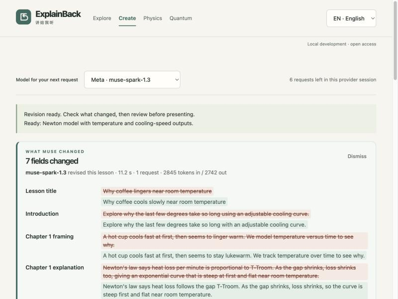

# Lesson Studio

The user asked to move lesson creation into ExplainBack so a topic can become a lesson that the app presents and operates. Carry forward the preference for direct implementation and the bilingual, claim-testing learning loop.

## Remembered lesson, cached results and guided replay (October 28)

**Remembered lesson.** The current draft, its review checkbox, the revision
prompt, the test learner's report, the show, the explain-back feedback and the
learner's own explanations are kept in this browser's `localStorage`
(`explainback-studio-draft`, `frontend/lib/studio-store.ts`) and restored when
Create is reopened or the page reloads, once access is confirmed. Gallery
lessons never restore. Nothing is sent to the server; invite codes, session ids
and tokens are not part of the draft and the store strips any field with such a
name before writing. **Start a new lesson** (the former Close lesson button)
forgets the remembered draft; Export and Import JSON work as before. When the
learner was presenting, the player position is rebuilt by replaying the engine's
own transitions (`restorePlayer`), so a restored state is one the engine could
have reached itself.

**Cached results, sent only on demand.** Each model-backed action (Create, Let
the test learner try, Revise, Check my explanation, Make a narrated show) keeps
its last successful reply with a fingerprint of the inputs it answered
(`frontend/lib/studio-cache.ts`). While the inputs are unchanged the reply shows
with *Cached result · unchanged since HH:MM · No model request was made*, and
the button reads **Re-run**. Any edit to the lesson, the revision prompt or the
explain-back text marks the reply stale and the button reads **Send changes to
Muse**. No action ever runs on mount, language switch or navigation; the
Studio tests and `e2e/lifecycle.spec.ts` assert zero `/api/studio` requests on
restore. The language is part of the tryout fingerprint, so a cached report is
stale in the other language and stays stale until the author re-sends.

**Guided replay.** Both players take a pace (off, slow, normal, fast; the
lesson player's select, the show player's *Pace*), remembered with the draft.
In the lesson player the replay advances predict → experiment (the experiment
plays itself on the existing 6 s timing scaled by the pace) → explain →
transfer on its own, with a progress bar for the current step; it chooses *Not
sure* when no prediction was made and reveals the lesson's own transfer answer,
and it never sends a model request. Any manual click pauses the replay; **Resume
replay** continues. Space pauses or resumes, ArrowRight steps forward,
ArrowLeft replays the experiment. In the show player the pace scales the
narration time and the speech rate, a manual step pauses playback, and the bar
tracks the whole show.

## What Muse changed (October 28)

**Restore previous draft** sits beside Dismiss on the panel. It discards the
revision, reloads the draft as it was before the request (review approval is
cleared again), and makes no model call.

## Sketch lesson in the gallery (October 28)

The gallery includes **Pendulum sketch: length and swing**, drafted by
`muse-spark-1.3` from the frozen pendulum sketch during the image evaluation
and lightly edited (a duplicated chapter removed, labels capitalised, the unit
symbol). The card shows the sketch itself, the card and the player name the
sketch as the source, and the image is served with the brand assets
(`/gallery/pendulum-sketch.png`, allowlisted in `src/static.mjs` and copied by
the build). It plays without sign-in like the other gallery lessons.

After an explicit **Revise lesson & demo** request, Studio keeps the previous
draft and shows a **What Muse changed** panel above the review: a field-by-field
comparison in the current language (title, intro, framing, explanation, demo
title, claim, assumptions, each input's label and range, each output's label,
unit and formula, axis, transfer question and values; for processes, each stage
and the choices). Removed text is struck through, new text is highlighted.
Switching language compares the other translation. The panel is a pure
comparison (`frontend/lib/lesson-diff.ts`); it does not judge whether a change
is correct, and the review gate still applies.

Every accepted create, revise or explain reply also shows a one-line request
summary: the model that answered, the server-measured elapsed time, and token
usage when the provider reports it. The server adds `model`, `elapsedMs` and
`usage` to those replies. The developer console remains the place for full
request and response bodies.

When a reply is rejected, the failure line now carries the reason: the 502
response includes `reason`, the validator's own one-line message (for example
"title needs both languages, each 1–80 characters." or "Use 3–6 process
stages."), bounded to 200 characters with configured secrets removed and never
a raw upstream body. The Studio shows it under "The request could not be
completed or validated", and the provider-activity record shows it next to
"failed or rejected". Provider and transport errors carry no reason: their text
never reaches the browser. The reason is a hint for the next attempt; the draft
and the request budget behave as before.

## Lesson show (October 28)

A show is the lesson as a narrated slide show. **Make a narrated show** (Draft
review) posts the validated draft to `/api/studio/show`. The creator model
answers one structured `make_show` call (`src/lesson-show.mjs`): 5–7 slides,
each with a kind (`cover`, `claim`, `experiment`, `evidence`, `transfer`,
`takeaway`), a chapter index, and a bilingual heading and narration (at most
360 characters per language), plus an English prompt for one cover
illustration. The reader enforces the order (one cover first, one takeaway last,
at least one experiment slide) and the lengths. The server then asks Muse Image
(`muse-image-1.0`, `POST /v1/images/generations`, `src/meta.mjs`
`generateMetaImage`) for the cover and returns it as a data URL; a failed image
never fails the show, and image bytes are not traced. A show costs one session
request and one image.

The player (`frontend/components/ShowPlayer.tsx`) renders every slide from the
checked lesson: the cover with the illustration, the claim, the real demo
sweeping its parameter over the narration time, the computed evidence and
metrics, the transfer question, and the authored explanation as the takeaway.
Narration is spoken by the browser's own speech synthesis in the chosen
language (a checkbox turns it off; without speech the show advances on a reading
timer). Arrow keys move, Escape closes. The credits line names the script model
and the cover model and says that the voice is the browser's, not a Meta model.

The six gallery shows were generated once with `npm run shows:gallery -- --live`
(Wonder scripts, Muse Image covers, `public/gallery-shows.mjs` and
`public/gallery/<id>-cover.webp`), reviewed, and play from `#show:<id>` without
sign-in or model calls. One English slide had a Chinese word leak in
("upright姿态"); it was corrected by hand, and the test suite checks that each
stored script still satisfies the reader's contract.

## Creator and test learner roles (October 28)

`/api/status` now reports `roles`: the **creator** (the configured
`muse-wonder-1.0`, else the default model) and the **tester** (the configured
`muse-spark-1.3`, else the default). The Studio starts on the creator for
drafting and revising, and the model selector is labelled "Creator model"; the
test learner is shown beside it and cannot be changed in the UI.

**Let the test learner try this lesson** (Draft review, below the definition)
posts the validated draft to `/api/studio/tryout`. The server always runs that
call on the tester role, whatever the session pinned for creation, and gives the
model only what a learner would see before the explanation: framing, claim,
assumptions, controls, observed values at three points (or the process stages)
and the transfer question, never the answer, hint or authored explanation
(`src/lesson-tester.mjs`, `learnerView`). The reply is one structured
`try_lesson` call: per chapter a prediction with a reason, an explanation in the
learner's own words, a transfer answer, up to three confusions and up to three
suggestions; then an overall note and a 1–5 clarity rating. The server checks
each transfer answer by code (numeric within the demo's tolerance, choices by
index) and rejects malformed reports; the opinions pass through unjudged.

The report shows the checked answers with correct/incorrect marks, the
confusions and suggestions, and the usual one-line request summary. **Use these
suggestions in a revision** copies the suggestions into the revision box so the
creator can act on them. A tryout spends one request from the session budget and
one from the reviewer quota, like any other call.

## Explain it back (October 28)

The Explain stage now asks the learner to write, before reading the reviewed
explanation, what changed in the experiment and why, in their own words (up to
700 characters, kept per chapter). With creation access, **Check my explanation
with Muse** sends that text with the same checked evidence the guide call
already receives. The reply is a graded assessment: a verdict (`supported`,
`partly` or `unsupported` by the checked result), feedback that names what the
learner got right and the single most important gap, one follow-up question
that must not reveal the answer, and the usual bounded next action. The server
requires all four fields when a learner explanation was sent and rejects any
other shape; without one, the plain "explain this result" contract is unchanged.
The learner text is untrusted subject matter in the prompt, never instructions.
Signed-out visitors still see the textarea and the reviewed explanation; the
feedback button is replaced by a note that it needs creation access.

### Spoken explanation (October 28)

With creation access on a server that has a Meta key, **Say it instead** records
up to one minute from the microphone through Web Audio (mono 16-bit PCM WAV at
16 kHz, resampled in the browser when the device runs at another rate; the
format Muse Voice Transcribe accepts) and posts it as base64 to
`/api/studio/transcribe` with the session and language. The server validates the
RIFF header, channel count, bit depth, sample rate and duration before anything
is forwarded, counts the request against the hourly budget but not the eight
lesson attempts, and calls `muse-voice-transcribe-1.0` (`POST
/v1/asr/transcribe`, multipart `request` + `audio`, push-to-talk mode, a
language bias of English or Chinese from the UI language). The transcript is
appended to the learner's textarea, marked "Transcribed by Muse Voice
Transcribe. Edit it, then check.", so the learner reviews it before **Check my
explanation with Muse**. Traces record sizes, duration and the transcript, never
audio bytes; a failed transcription is a 502 with a plain message and the
textarea stays usable. Browsers without microphone access or Web Audio get a
one-line note instead; the button is hidden when `/api/status` reports
`voice: false`. Live check Oct 28: a 6.9 s synthetic English sentence
transcribed word for word in 2.2 s; a 6.1 s Mandarin sentence transcribed in
2.4 s with its first syllable dropped.

## Image input and model choice (October 28)

**Add a photo, sketch or diagram** sits above the Create button. The browser
reads the file, downscales anything over about 1 MB to at most 1280 px JPEG,
shows a thumbnail, and sends the data URL once with the compose request. The
server accepts PNG, JPEG, WebP or GIF data URLs up to 1.2 million characters,
forwards them as a Responses user message with `input_text` and `input_image`
parts, and records only `[image omitted · N chars]` in traces. A topic is
optional when an image is attached. Muse is told the image is untrusted subject
matter and asked to say in its message what it saw and what it could not read.
Image input needs a Meta model; selecting a local Ollama model returns a clear
error without sending anything.

The model selector now offers **muse-spark-1.3** (default) and
**muse-wonder-1.0** locally and on Vercel. Wonder is larger and slower, so its
request budget is 50 s against Spark's 30 s. Switching models starts a new
provider session and keeps the draft.

## Studio-first presentation (October 27)

Studio is now the default entry. A short Create → Review & revise → Operate
walkthrough introduces the flow, with editable topic/revision starters and the
existing review gate. See the [demo script and current verification](studio-demo.md)
and [12-case frozen evaluation](studio-evaluation.md). Earlier counts below remain
historical. Current local validation: 221 tests; build and configured-secret scan passed.

## Open-topic creation (current)

The default **Create a new topic demo / 创建新主题演示** mode asks Muse to author a version 2 lesson rather than select a fixed experiment. Two generic renderers support new topics without adding topic-specific application code:

- **Mathematical model:** one to four adjustable inputs, an independent axis and one to three formula outputs. Play or scrub the graph, choose an output, change inputs, and answer a new numerical case computed from the same formulas.
- **Process diagram:** three to six interactive stages with play, scrub and direct step selection. A multiple-choice transfer question checks against the authored answer, explicitly labeled as unverified.

The eight original experiments remain available through **Use existing experiments / 使用原有实验**. Version 1 files still work. Version 2 permits one to three chapters and up to 24 KB of compact JSON; file import permits 40 KB for formatting. Version 1 retains its 12 KB content bound. Generated creation normally asks for one focused chapter. Topics unsuitable for either renderer may be declined rather than forced into an unrelated catalog lesson.

### Create, review, present, operate

1. Sign in, open Create a lesson, choose a preset or enter a new question, and generate a draft. Meta remains the default. The app sends one provider request per explicit action.
2. Inspect the bilingual claim, assumptions, parameter ranges and formulas or process steps. Edit teaching text, edit the structured definition, or enter a revision request for Muse. Invalid definition edits preserve the last valid draft and block presentation until applied or discarded.
3. Acknowledge review of generated definitions and present. Editing, importing or regenerating clears this acknowledgment; exported files never carry approval.
4. Predict, operate, reconcile and transfer. Parameter changes reset the prediction and evidence. Language switching preserves the current demo and inputs. Optional Muse explanations receive server-recomputed model values; suggestions are applied only when the learner clicks.
5. Export to preserve the bilingual definition; drafts otherwise live only in this page's memory. Logout clears the draft and discards pending responses. The provider console remains controlled by the existing trace flag.

### Trust and execution boundaries

Generated definitions are data, never executable JavaScript, HTML or network instructions. The arithmetic interpreter supports numeric literals, named inputs, `x`, `pi`, `e`, `+ - * / ^`, and `sin`, `cos`, `exp`, `log`, `sqrt`, `abs`, `min`, `max`. Outputs may reference earlier outputs. Bounded parsing, finite result checks and conservative interval analysis reject unsupported expressions, cycles, singularities and unsafe domains across declared ranges. Conservative interval checks can reject mathematically valid correlated expressions; simplifying a formula or narrowing its domain can help.

These checks establish supported structure and computable arithmetic, **not scientific truth, dimensional consistency, or factual accuracy**. Numeric transfer answers follow the authored formulas. Process steps and answer keys have no independent factual validator; stage order is not physical time. Reviewers must check explanations, units and assumptions before teaching from them. The model cannot create arbitrary 3D simulations, real CFD engines or additional executable widgets through this contract.

Provider routing, tester authentication, ownership, quotas, locks, trace redaction and exclusive Ollama scheduling are reused. No simultaneous Ollama execution or automatic retry was introduced. The original catalog and earlier prototype remain separate baseline work.

### Open-topic verification

Completed three planned context-iterate rounds (ceiling five). All 202 tests pass, including generated contract rejection, arithmetic/domain checks, tiny-value rendering and answer tolerance, review invalidation, bilingual state, guide recomputation and HTTP validation. An independent code review identified tiny-value issues; regression tests cover the fixes. Build, configured-secret scan and diff whitespace checks pass.

Live Meta checks created an exponential cooling demo, explained changed parameters in Chinese, and revised the demo to add a second output. At the default values its final temperature was 20.535 degC; changing the cooling rate from 0.08 to 0.17 changed it to 20.002 degC. These numbers are formula results, not measurements. Browser checks covered playback, parameter resets, output selection, English/Chinese preservation, rejected wrong answers and a completed numerical transfer case.

A Chinese web-loading topic produced an interactive process lesson. The first response split stage titles/details into separate objects; validation rejected it and retained the cooling draft. After adding an explicit complete-stage example to the prompt, one new explicit request succeeded. Direct step selection, playback, bilingual transfer choices, wrong-answer blocking and completion worked. In-app JSON editing removed duplicate authored step numbers and correctly revoked presentation approval. No duplicate IDs or horizontal overflow appeared at the current 1280 px viewport. Four live requests were accepted across the two sessions; one malformed response was rejected. Ollama was not invoked. Screenshot: local/ignored `output/open-topic-studio.png`.

Both browser drafts were kept open. Automatic approval review prevented reloading the unsaved cooling draft, so the final process check used a separate tab. No commit or deployment was performed.

## Original catalog baseline

Add a third learning area. Muse (or another configured provider) selects and sequences one to three existing, deterministic experiment types, writing English and Chinese titles, framing, and explanations. The author reviews and edits the text, then starts a player: predict → operate the experiment → reconcile the result → answer a fresh numerical transfer question. The player pauses between these stages. Playback and a scrubber operate a trusted renderer; the model never supplies executable HTML, JavaScript, formulas, URLs, or new simulation engines.

The initial catalog covers acceleration, roll, landing, suction, qubits, interference, entanglement, and four-item quantum search. Claims, calculated evidence, parameter variants, transfer answers and assumptions come from application code. Generated teaching text is visibly labeled as a draft, not checked scientific evidence. Unsupported topics receive an honest coverage message. This choice prioritizes runnable lessons over unrestricted slide generation or arbitrary generated code.

Drafts can be edited, reordered, removed (at least one chapter), exported as versioned JSON, and imported with the same strict validator. No silent local persistence; downloads are the durable artifact. Import does not execute code or create provider calls. Language switching preserves the lesson and playback position. All authored text renders as text, never markup.

Creation and optional explanations use the existing provider router, Meta default, tester authentication, ownership checks, rate limits, session locks, trace flag/redaction and Ollama exclusivity. No automatic retries. Provider explanations can suggest a bounded action; the learner explicitly applies it. Logout clears the in-memory draft/player and discards pending responses. Authored text and imported text are untrusted data.

## Initial implementation and verification

1. Add a versioned, size-bounded lesson contract and experiment adapters over the existing math modules; test invalid content and independent numeric expectations.
2. Add authenticated composition and explanation endpoints with native tools and server-computed evidence; test ownership, reset races, protocol isolation, limits and rejected output.
3. Build the bilingual author/player UI with export/import, playback, transfer checking and optional provider console. Keep existing areas intact.
4. Run focused and full tests, build and secret checks; exercise real creation, presentation, language switch and console in the browser. Request a fresh code review and resolve material findings.

No commit, push or deployment is part of this request. Existing prototype/baseline files remain identified separately.

## Initial catalog verification

Open **Create a lesson / 创建课程** after tester sign-in. Choose a preset or type a topic, then create one bilingual draft. Review the canonical claims and edit the title, introduction, framing or explanation in the selected language. Reorder/remove chapters if needed, then present. Each chapter pauses for a prediction, a local experiment, explanation, and a numerical transfer check. Import/export preserves both languages; the JSON contract is version 1, one to three distinct experiments, maximum 12 KB compact content (20 KB file allowance for formatting). Browser memory is cleared on logout; export before closing/reloading the page.

The model may suggest replay, comparison or transfer during an explanation. Apply that suggestion explicitly. Language switching retains the lesson and completed provider trace; changing language during an active request discards that request's result. Switching models starts a fresh provider session while retaining the lesson. There are eight provider attempts per Studio session and the existing shared hourly quota. Exhaustion recovery is explicit; no automatic retry or Ollama concurrency changes.

Quantum curves show pre-measurement probabilities. A single readout measures a separate copy; repeated readout of that copy preserves the result, while 256-shot sampling re-prepares each trial. Entanglement includes the classical-mixture comparison in the same basis. Quantum gate snapshots are discrete, and the physical model boundaries remain explicit.

Validation: 193 tests passed, including contract, numerical adapters, progression, independent transfer cases, API auth/ownership/output validation/exhaustion, logout races, and stale measurement reset. Two code-review passes identified issues that were reproduced and fixed; the final focused re-review found no remaining material issue. Live Meta creation and in-lesson explanation succeeded. Browser checks covered editable bilingual output, guided playback, applying a suggested comparison, export/reimport, incorrect-answer blocking and completion of all three physics chapters. Generated framing needed one editorial correction in the first smoke test; generated teaching text remains explicitly reviewable rather than scientifically certified.

A second live creation from a Chinese topic produced a qubit → interference → search lesson (HTTP 200, accepted). A single simulated readout returned one bit; the fresh 256-shot sample displayed 130 zeros and 126 ones in this run. Switching to English preserved these observations and the provider trace. The browser showed both filtered request and response panels, no duplicate element IDs, and no horizontal overflow at its current 654 px width. The build and configured-secret scan passed. Ollama was not invoked. Preview screenshot is local/ignored under `output/lesson-studio-preview.png`.
