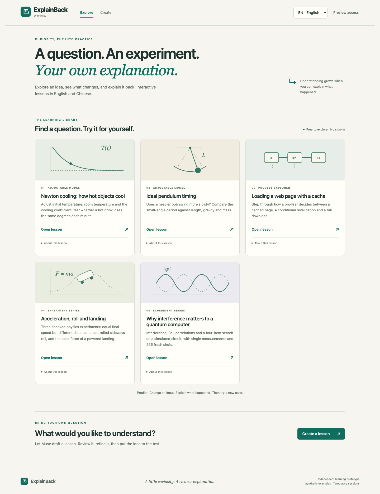
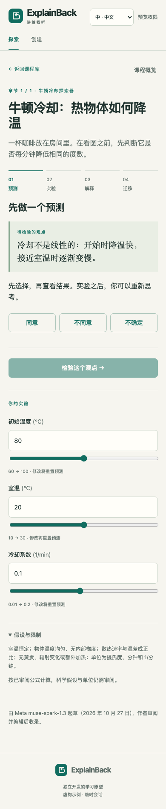

# React UI and branding verification

October 28, 2026 Pacific. Local implementation on `codex/react-studio-branding`,
based on `ba4da7a5182df30b399baad37a03494e4565ccf9`. No commit, push, merge or
deployment is implied. The [shared ledger](implementation/progress-ledger.md)
is the Codex/Claude handoff.

## What changed

React owns the shell, bilingual navigation, reviewer/tester access, gallery,
authoring, review and lesson player. TypeScript covers that interface; the
existing formula compiler, lesson schema, player engine and scientific models
remain JavaScript modules. Physics and quantum are scoped, lazy-loaded adapters.
There is one Node API and one same-origin cookie/auth boundary in development
and production; no extra backend service or SSR migration was introduced.

The paper/green identity now includes a source SVG mark, SVG and multi-size ICO
favicons, 180px touch icon and 1200×630 share card. An explicit allowlist serves
brand assets locally and copies the same files into the production output.
Metadata preserves the existing noindex policy. Raster assets are reproducible
with `node scripts/brand-assets.mjs` after installing Playwright Chromium.

The new library uses lesson illustrations and source disclosures; the authoring
workspace separates creation, review and experimentation. Public lessons retain
local playback without model calls. Imports and edits reset review approval;
invalid definitions cannot replace the last valid lesson. Images are prepared
locally and submitted only on the explicit Create action. Language changes and
logout invalidate pending Studio responses.

## Evidence

Runtime: Node **22.23.1**. Locked tooling: React/React DOM **19.3.1**, Vite
**8.3.5**, TypeScript **7.0.2**, React Vite plugin **6.1.2**, Playwright **1.64.1**.

- `npm test`: **245/245 passed** (244 existing plus brand/static boundary test).
- `npm ci --ignore-scripts`: clean lockfile install passed.
- `npm run typecheck`: passed.
- `npm run build`: passed; separate lazy lab chunk. Initial JS approximately
  **350 KB / 118 KB gzip**, down from the migration's first all-in-one 528 KB /
  183 KB gzip build. This comparison is between two migration builds, not an
  assertion that React is smaller than the original plain-JavaScript app.
- `npm audit --json`: **0 vulnerabilities reported** at this checkpoint.
- `npm run test:browser`: **18/18 Chromium workflows passed** after the review fixes.
- Development server served the root, SVG/ICO/touch/share assets and `/api/auth`
  with expected content types; `/.env.local` returned **403**. Production HTTP
  tests returned **404** for arbitrary repository paths and traversal inputs.
- EN/ZH library checked at **320, 390, 768 and 1440 CSS pixels**, with no horizontal
  overflow or browser exceptions. Keyboard skip link and reduced-motion styling
  exercised. Desktop and mobile screenshots inspected directly.

Browser fixtures are synthetic and use the real local API with a deterministic
provider stub. They check gallery language/progress, a complete process lesson,
parameter edits, invite entry, review/edit gates, import/export, revision, invalid
JSON, image submission, stale Studio replies, logout, both retained labs,
unknown links and mobile layout. They make **no paid or live model calls**.

The initial brand HTTP test failed with `/favicon.svg` 404; the React navigation
browser test failed against the old page. Parameter focus reproduced an unwanted
progress reset before its correction. These were implementation failures fixed
and rechecked, not passing checks inferred from source.

## Screens and reproduction

`node scripts/capture-ui.mjs` captures four synthetic local screens into
`output/ui-review/`: desktop library, mobile Chinese library/player and desktop
authoring. Run after `npm run build`; port 4187 must be free. This helper and the
browser suite stop only their own fixture server.

## Boundaries

Chromium desktop/mobile emulation is verified; native Safari/iPhone and other
browser engines were not tested in this pass. Live model behavior, teaching
accuracy, current production state and hackathon eligibility are separate from
these checks. Existing legacy DOM tests remain useful for core contracts but do
not substitute for the new React browser tests. Raw legacy modules remain in
`public/` for retained adapters and compatibility; `index.html` and `frontend/`
are the Vite application entry points.

## Final-review follow-up

One independent reviewer examined the complete tracked and untracked migration.
Four material findings were reproduced and fixed:

1. Authored content now has its own persistent Studio instance. Explore, Create,
   browser history and public gallery playback do not discard imported/generated
   drafts or pending review edits. Explicit Close and logout still clear state.
2. Gallery instances follow the actual route, including Back/Forward and unknown
   hashes; browser history cannot leave the previous player on screen.
3. Language changes invalidate pending manual physics work. Already accepted
   evidence remains visible, late replies cannot overwrite it, and a clear notice
   asks for a session reset before further model requests in the new language.
4. Hidden workspaces/documents stop diagnostic polling. Provider-console event
   listeners, document listeners and lab ResizeObservers are released on unmount.

The reviewer rated the ResizeObserver retention minor; it was included in the
lifecycle fix because repeated authenticated mounts retained detached lab trees.
A browser regression observed the leak before the fix and zero observers after
logout. No review findings remain deferred.

Six review regressions were observed failing before the fixes and passing after.
A further regression confirmed that an authored animation pauses while its
library is visible; expired-access coverage confirms private drafts are cleared.
Final result: **245 Node tests + 18 browser tests passed**, typecheck/build passed.
No second review was substituted for those reproductions.

Implementation choices: retain one shared Codex/Claude ledger and the existing
checkout on a feature branch, with HEAD checked before/after; retain the Node API
and pure scientific engines instead of rewriting working contracts. These choices
minimize migration scope, while requiring continued shared-checkout coordination
and keeping the scoped legacy adapters as a deliberate migration boundary.
